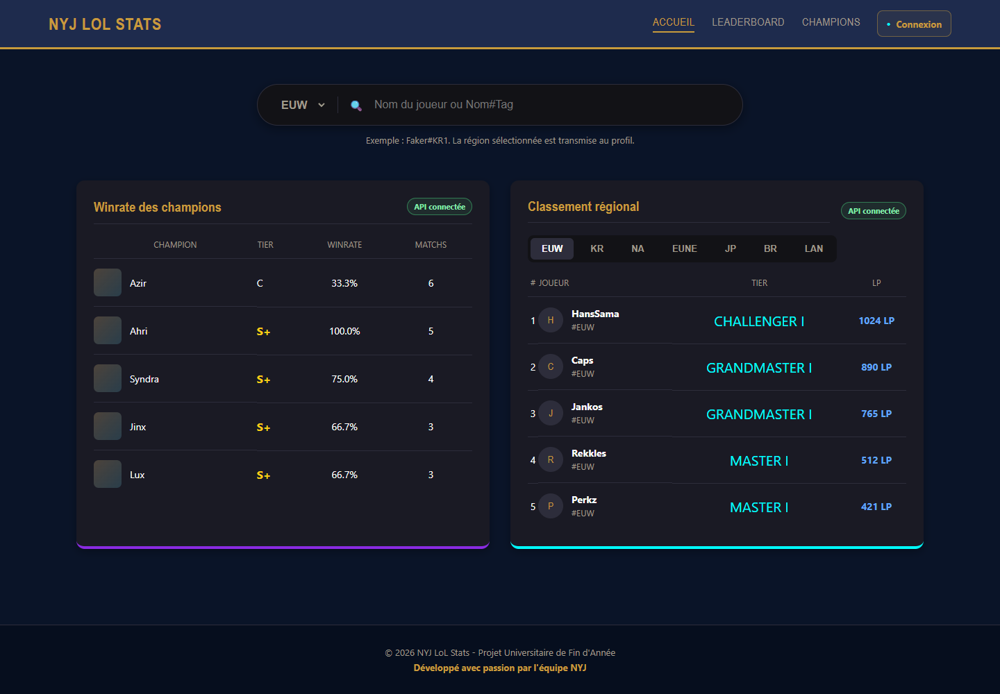
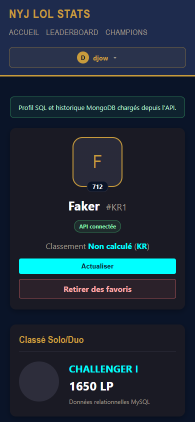
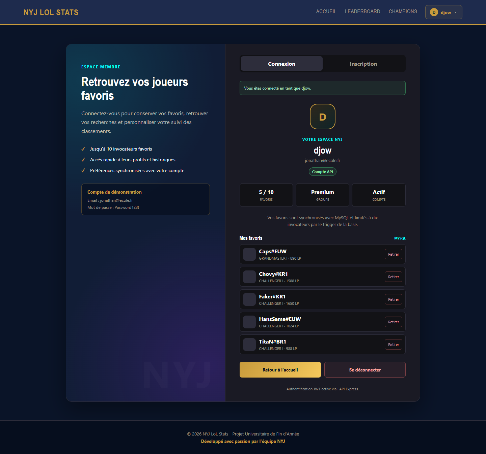

# LoL Tracker

Application web responsive de suivi de statistiques et de classement de joueurs
*League of Legends*. Ce projet universitaire combine une interface en HTML, CSS
et JavaScript avec une API Express, MySQL et MongoDB.



## Contexte et contribution

Projet collectif réalisé en Bachelor 3 à la Paris School of Technology &
Business, dans le cadre du module **Bases de données avancées**.

**Équipe :** Nicolas Chen, Jonathan Liao et Yannis Leveneur.

**Contribution de Yannis Leveneur :** conception et développement du front-end,
notamment la structure des pages, le style responsive, la navigation, les écrans
de connexion et de profil, ainsi que l'intégration de l'interface avec les routes
de l'API réalisées par l'équipe.

Le back-end, la modélisation des bases et l'intégration globale ont été réalisés
collectivement. Le dépôt est publié comme projet académique de démonstration et
utilise des données fictives.

### Interfaces réalisées

| Accueil et classement | Profil mobile | Espace membre |
|---|---|---|
|  |  |  |

L'application combine deux bases de données aux rôles complémentaires :

- **MySQL** (relationnel) : utilisateurs, groupes, régions, invocateurs, favoris.
- **MongoDB** (documentaire) : historique des matchs et statistiques calculées par agrégation.

---

## Sommaire

- [Stack technique](#stack-technique)
- [Contexte et contribution](#contexte-et-contribution)
- [Architecture du dépôt](#architecture-du-dépôt)
- [Prérequis](#prérequis)
- [Lancement avec Docker](#lancement-avec-docker)
- [Initialisation des données](#initialisation-des-données)
- [Variables d'environnement](#variables-denvironnement)
- [Documentation de l'API (Swagger)](#documentation-de-lapi-swagger)
- [Aperçu des endpoints](#aperçu-des-endpoints)
- [Comptes de démonstration](#comptes-de-démonstration)
- [Authentification](#authentification)
- [Workflow Git](#workflow-git)

---

## Stack technique

| Composant   | Technologie                        | Port  |
|-------------|------------------------------------|-------|
| Back-end    | Node.js 22 / Express               | 3000  |
| Front-end   | HTML / CSS / JS servis par Nginx   | 8080  |
| Base SQL    | MySQL 8.0 (réseau Docker interne)  | 3306  |
| Base NoSQL  | MongoDB (réseau Docker interne)    | 27017 |
| Orchestration | Docker Compose                   | —     |

Bibliothèques back principales : `express`, `mysql2`, `mongoose`, `jsonwebtoken`,
`bcrypt`, `helmet`, `cors`, `dotenv`, `swagger-ui-express`, `swagger-jsdoc`.

---

## Architecture du dépôt

```
.
├── BackEnd/
│   ├── src/
│   │   ├── app.js                 # Point d'entrée Express
│   │   ├── config/                # Connexions (db.js, mongo.js) + Swagger
│   │   ├── controllers/           # Logique de requête/réponse HTTP
│   │   ├── services/              # Accès aux données (SQL / Mongo)
│   │   ├── models/                # Schéma Mongoose (Match.js)
│   │   ├── middlewares/           # authMiddleware (JWT)
│   │   └── routes/                # Définition des routes + doc Swagger
│   ├── Dockerfile
│   └── package.json
├── Front/                         # Interface HTML, CSS et JavaScript (Nginx)
├── database/
│   ├── init.sql                   # Schéma + données SQL (auto au démarrage)
│   └── init-mongo.js              # Données de démo MongoDB (auto au démarrage)
├── docker-compose.yml
├── .env.example                   # Modèle de configuration (à copier en .env)
└── README.md
```

---

## Prérequis

- [Docker](https://www.docker.com/) et Docker Compose installés.
- Aucun autre outil n'est nécessaire : Node, MySQL et MongoDB tournent dans les conteneurs.

---

## Lancement avec Docker

À la racine du projet :

```bash
docker compose up --build
```

Cette commande construit et démarre les quatre conteneurs. Au premier lancement,
ajoutez `--build` pour forcer l'installation des dépendances. Une fois démarré :

- Front-end : http://localhost:8080
- API : http://localhost:3000/api
- Documentation API : http://localhost:3000/api-docs

Pour tout arrêter :

```bash
docker compose down
```

> Pour repartir d'une base vierge (réinitialiser MySQL et MongoDB) :
> `docker compose down -v` (le `-v` supprime les volumes de données).

---

## Initialisation des données

**MySQL** est initialisé **automatiquement** au premier démarrage : le dossier
`database/` est monté dans `/docker-entrypoint-initdb.d`, donc `init.sql`
(schéma, vues, triggers, procédures, données de démo) s'exécute tout seul.

**MongoDB** est également initialisé automatiquement au premier démarrage grâce
au script `database/init-mongo.js` monté dans `/docker-entrypoint-initdb.d`.
Il crée la collection de matchs et charge les données de démonstration.

---

## Variables d'environnement

La configuration passe par un fichier `.env` à la racine (non versionné).
Copiez le modèle fourni puis adaptez si besoin :

```bash
cp .env.example .env
```

Variables attendues : secret de signature des tokens (`JWT_SECRET`) et ports
locaux (`FRONT_PORT`, `API_PORT`). Le fichier `.env` ne doit jamais être commité.

Les identifiants présents dans `docker-compose.yml` et les comptes listés plus
bas sont réservés à l'environnement local de démonstration. Ils ne doivent pas
être réutilisés dans un déploiement réel.

---

## Documentation de l'API (Swagger)

Une documentation interactive est générée automatiquement à partir des
commentaires des routes et disponible à l'adresse :

```
http://localhost:3000/api-docs
```

Elle liste tous les endpoints, leurs paramètres et permet de les tester
directement. Pour les routes protégées, utilisez le bouton **Authorize** et
collez un token obtenu via `/api/auth/login`.

---

## Aperçu des endpoints

Base : `http://localhost:3000/api`

| Domaine      | Méthode | Route                                | Protégée |
|--------------|---------|--------------------------------------|----------|
| Auth         | POST    | `/auth/register`                     | non      |
| Auth         | POST    | `/auth/login`                        | non      |
| Auth         | GET     | `/auth/me`                           | oui      |
| Auth         | POST    | `/auth/logout`                       | oui      |
| Utilisateurs | GET     | `/utilisateurs`                      | non      |
| Utilisateurs | GET     | `/utilisateurs/:id`                  | non      |
| Utilisateurs | POST    | `/utilisateurs`                      | non      |
| Utilisateurs | PUT     | `/utilisateurs/:id`                  | oui      |
| Utilisateurs | DELETE  | `/utilisateurs/:id`                  | oui      |
| Invocateurs  | GET     | `/invocateurs`                       | non      |
| Invocateurs  | GET     | `/invocateurs/recherche`             | non      |
| Invocateurs  | GET     | `/invocateurs/:puuid`                | non      |
| Invocateurs  | PATCH   | `/invocateurs/:puuid/solo-stats`     | oui      |
| Favoris      | GET     | `/favoris`                           | non      |
| Favoris      | GET     | `/favoris/utilisateur/:id`           | non      |
| Favoris      | POST    | `/favoris`                           | oui      |
| Favoris      | DELETE  | `/favoris/:id`                       | oui      |
| Matchs       | GET     | `/matchs`                            | non      |
| Matchs       | GET     | `/matchs/stats/:puuid`               | non      |
| Matchs       | GET     | `/matchs/invocateur/:puuid`          | non      |
| Matchs       | POST    | `/matchs`                            | oui      |
| Champions    | GET     | `/champions/statistiques`            | non      |
| Santé        | GET     | `/health`                            | non      |

Les routes `stats`, `champions/statistiques` et `matchs` exploitent le
**framework d'agrégation MongoDB** (`$unwind`, `$group`, `$project`).

---

## Comptes de démonstration

Créés par `init.sql` (mot de passe haché avec bcrypt) :

| Email                | Mot de passe   |
|----------------------|----------------|
| `jonathan@ecole.fr`  | `Password123!` |
| `nicolas@ecole.fr`   | `Password123!` |

---

## Authentification

L'API utilise des **JSON Web Tokens (JWT)**. Le parcours type :

1. `POST /api/auth/login` avec email + mot de passe → renvoie un `token`.
2. Pour les routes protégées, envoyer l'en-tête :
   `Authorization: Bearer <token>`.

La déconnexion (`/auth/logout`) est gérée côté client : le serveur ne stocke
pas de session, le client supprime simplement le token.

---

## Workflow Git

- Branche `main` : version stable et protégée.
- Branche `dev` : intégration du travail de l'équipe.
- Branches `feat/...` : développement d'une fonctionnalité.

Convention de commits : *Conventional Commits* (`feat:`, `fix:`, `docs:`...).

---

## Limites et pistes d'amélioration

- Données de démonstration : aucune synchronisation en production avec l'API Riot Games.
- Tests réalisés manuellement ; une suite automatisée avec Jest ou Mocha reste à ajouter.
- Déploiement public et pipeline CI/CD non configurés.
- Les identifiants locaux doivent être remplacés avant tout déploiement.

Ce projet n'est ni approuvé ni affilié à Riot Games. *League of Legends* est une
marque de Riot Games.
